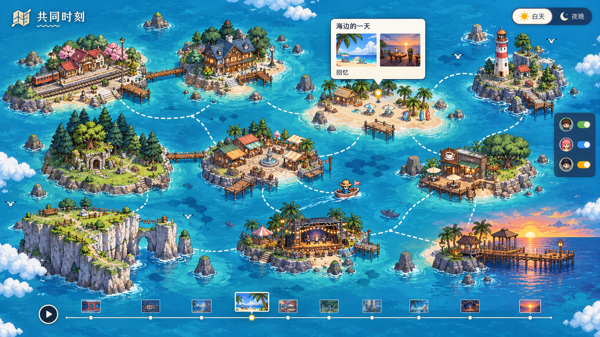
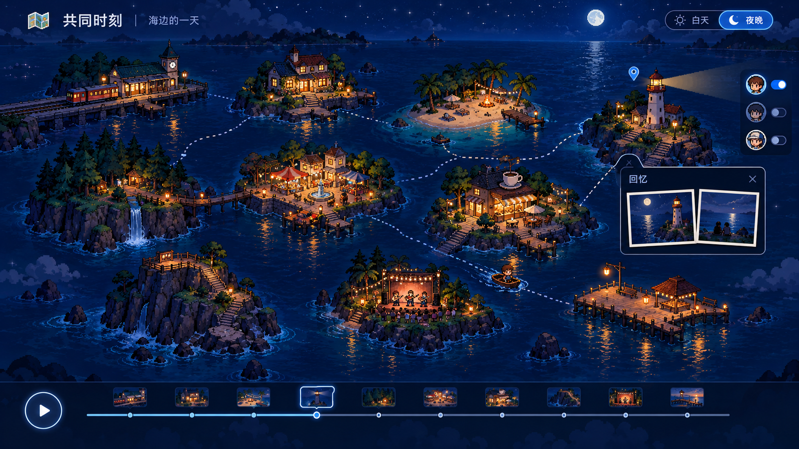
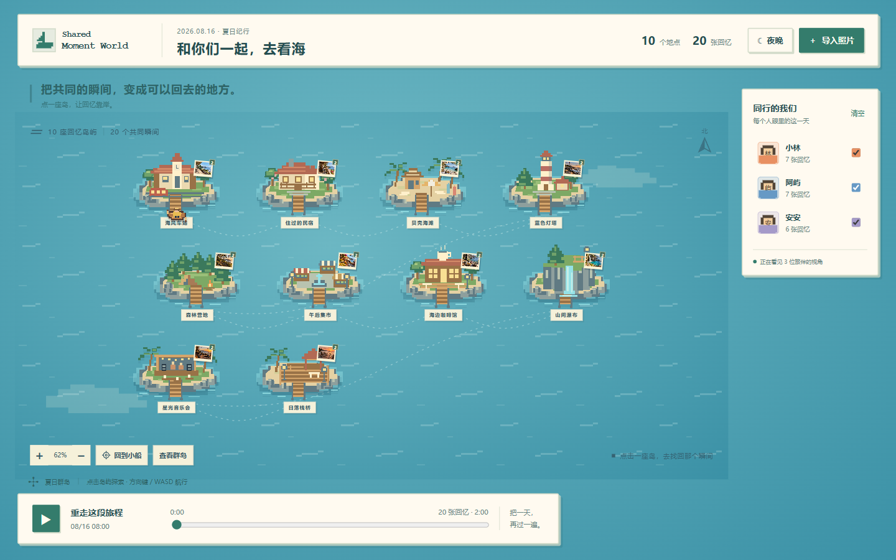
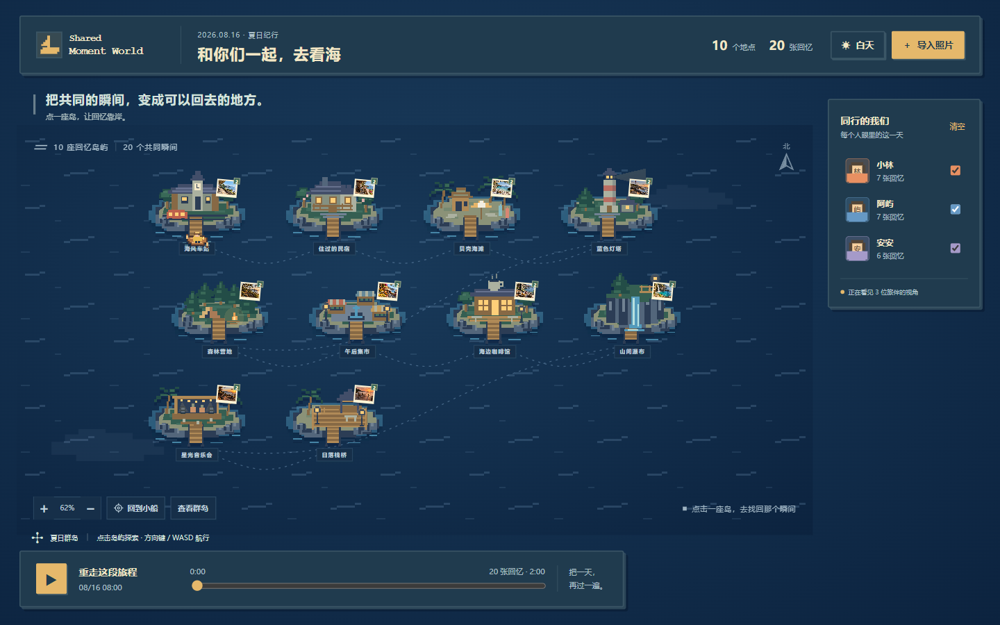

# 共同时刻世界 MVP

当前是保留的原型版本。代码检查通过，但用户已指出 UI 和核心功能与预期不同，需要另行大幅调整；本版不作为已认可的成品方案。

代码在 [frontend](../../frontend/README.md)。这是像素群岛、三位旅伴与照片回忆组成的纯前端演示；每座岛代表一处地点，新增照片可生成更多岛屿。

## 现场演示

启动后：点海滩岛 → 等小船靠岸 → 看照片大图 → 切换旅伴 → 切到夜晚 → 播放/拖动时间轴 → 用WASD接管小船。导入照片时先选择拍摄者，无GPS图片可放进现有岛或新建地点。刷新恢复虚构旅行。

## 模拟图

以下是 ImageGen 内置工具生成的视觉探索图，包含概念排版；实际页面由独立Vue/SVG组件构建，不把整张图当互动地图。

## 实际页面与验证

实际页面已检查1440×900、1280×720、390×844的两套主题。命令与架构见 [前端总览](../../frontend/doc/README.md)，具体检查见 [验证记录](../../frontend/doc/verification.md)。示例素材为AI生成的20张虚构旅行照片；岛屿、船与人物是代码绘制的像素图形。

窄屏截图：[白天](actual-390-day.png)、[夜晚](actual-390-night.png)。1280宽截图：[白天](actual-1280-day.png)、[夜晚](actual-1280-night.png)。
